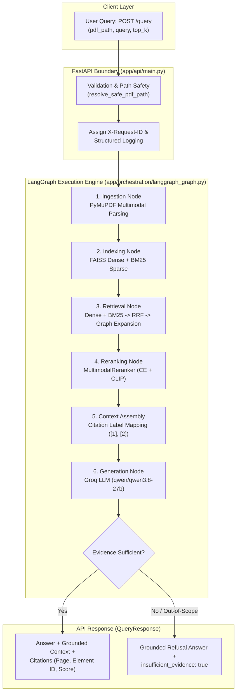

# PaperMind

> **Multimodal Scientific Research Paper Assistant with Hybrid RRF Retrieval, Visual Relationship Expansion, Cross-Encoder Reranking, and Grounded Generation.**

[](https://www.python.org/)
[](https://fastapi.tiangolo.com/)
[](https://langchain-ai.github.io/langgraph/)
[](https://github.com/facebookresearch/faiss)
[](https://www.sbert.net/)
[](https://www.docker.com/)

---

## 1. Executive Summary

**PaperMind** is an end-to-end Retrieval-Augmented Generation (RAG) system engineered specifically for dense, multimodal scientific papers. Unlike generic RAG systems that flatten PDFs into naive text chunks, PaperMind preserves the document's heterogeneous topology—extracting, indexing, and linking narrative prose, figure captions, visual diagrams, equations, and tables with full citation provenance.

It employs a multi-stage retrieval architecture: **dense semantic embeddings** (FAISS) and **sparse lexical search** (Okapi BM25) fused via **Reciprocal Rank Fusion (RRF)**, dynamically enriched by **1-hop caption-to-image relationship expansion**, and prioritized using a **multimodal cross-encoder reranker**. Answers are synthesized strictly from retrieved evidence via Groq-hosted open LLMs (`qwen/qwen3.8-27b`), complete with brackets-mapped structured citations and deterministic refusal guards for out-of-scope queries.

---

## 2. Problem Statement: Why Scientific Paper Retrieval is Hard

Standard text-only RAG pipelines systematically fail on academic and technical literature for three primary reasons:

1. **Lost Visual Evidence:** Critical claims in machine learning and systems papers are frequently embedded inside architectural diagrams, loss curves, and benchmark tables. Naive text extraction completely drops or isolates images from their explanatory captions.
2. **Vocabulary Mismatch vs. Exact Term Sensitivity:** Scientific queries often contain strict token exactness (e.g., `d_k` scaling factor, `bleu-4`, `MITRE ATLAS`) where pure dense vector search hallucinates semantically adjacent but technically incorrect passages. Conversely, pure keyword search fails on high-level conceptual questions.
3. **Cross-Encoder Visual Blindness:** Pre-trained cross-encoders (like `ms-marco-MiniLM-L-6-v2`) operate exclusively on text pairs. Passing raw binary image assets directly to a text cross-encoder severely penalizes them, causing diagrams to be evicted from the top-k candidate pool right before context assembly.

PaperMind addresses these fundamental engineering challenges through structured element typing, hybrid RRF fusion, relationship graph expansion, and specialized visual reranking.

---

## 3. Implemented Capabilities

- **Multimodal Document Parsing:** PyMuPDF-based extraction isolating `TEXT`, `CAPTION`, `IMAGE`, `TABLE`, and `EQUATION` elements while establishing structural bidirectional relationships (e.g., figure captions mapped to corresponding image blocks).
- **Hybrid Search (Dense + Sparse):** Parallel execution of 384-dimensional dense semantic search (FAISS IndexFlatIP with `all-MiniLM-L6-v2`) and deterministic Okapi BM25 sparse search over text-like elements ($k_1=1.5, b=0.75$).
- **Reciprocal Rank Fusion (RRF):** Scale-invariant rank fusion ($k=60$) combining disparate score distributions without heuristic score normalization bias.
- **Multimodal Relationship Expansion:** Deterministic 1-hop graph expansion ensuring that when a figure caption is retrieved, its associated image element enters the candidate pool before final reranking.
- **Dual-Path Reranking:** Automatic routing: pure text documents use `CrossEncoderReranker`; documents with visual assets use `MultimodalReranker` blending text cross-encoder scores ($80\%$) and CLIP ViT-B-32 visual query-image similarity ($80\%$) with RRF ranks ($20\%$).
- **Stateful LangGraph Orchestration:** Compiled deterministic state graph managing ingestion, indexing, retrieval, reranking, and generation with typed error transitions.
- **Grounded Answer Synthesis & Provenance:** Generation via Groq API (`qwen/qwen3.8-27b`) constrained by strict system boundaries to prevent hallucinations, formatting inline citations (`[1]`, `[2]`) referencing document, page number, and element ID.
- **Production Guardrails & Reliability:** Regex-based grounded refusal for unsupported questions, 50 MB PDF size limits, path-traversal protection, and 30-second LLM timeouts.
- **Structured JSON Observability:** Three named standard-library loggers (`papermind.api`, `papermind.retrieval`, `papermind.generation`) correlating request latency, candidate counts, and sanitized errors with `X-Request-ID`.

---

## 4. Architecture Overview

PaperMind is organized into a modular pipeline orchestrated as a **LangGraph StateGraph** and served via **FastAPI**.



*For in-depth architectural specifications and subsystem details, see [docs/architecture.md](docs/architecture.md).*

---

## 5. End-to-End Retrieval & Reranking Flow

The retrieval pipeline processes queries through six distinct stages:

```mermaid
flowchart LR
    Q[Query] --> D[Dense FAISS\n384-d Cosine]
    Q --> S[Sparse BM25\nOkapi k1=1.5, b=0.75]
    D --> RRF[Reciprocal Rank Fusion\nk=60]
    S --> RRF
    RRF --> EXP[1-Hop Relationship\nExpansion (Caption -> Image)]
    EXP --> POOL[Candidate Pool\nTop-10 Candidates]
    POOL --> RERANK[Multimodal Reranker\nCE 80% / CLIP 80% + RRF 20%]
    RERANK --> TOPK[Final Top-5\nGrounded Context]
```

1. **Dual Candidate Generation:** Query is embedded via `sentence-transformers/all-MiniLM-L6-v2` and searched against text and visual FAISS indexes. Simultaneously, deterministic alphanumeric tokenization searches the BM25 inverted index.
2. **Rank Fusion (RRF):** Dense and sparse candidate lists are fused using $RRF(d) = \sum_{r \in R} \frac{1}{60 + \text{rank}(d, r)}$. Scores are replaced with pure RRF ranks, breaking ties deterministically by element ID.
3. **Relationship Expansion:** For every retrieved caption element, directly referenced image IDs (`related_element_ids`) are pulled into the candidate set.
4. **Candidate Pool Windowing:** Truncated to `DEFAULT_RERANK_CANDIDATE_POOL = 10` (optimized from 20 for latency).
5. **Multimodal Reranking:** 
   - Text chunks are scored via `cross-encoder/ms-marco-MiniLM-L-6-v2`.
   - Image chunks are scored via text-query/image cosine similarity using `sentence-transformers/clip-ViT-B-32`.
   - Scores are blended: $0.80 \times \text{Model}_{\text{norm}} + 0.20 \times \text{RRF}_{\text{norm}}$.
6. **Context Assembly:** Top $k$ (default 5) results are assembled with sequential citation tokens `[1]`, `[2]`, preserving page number, element type, and content.

---

## 6. Verified Experimental Results

All metrics are sourced directly from saved JSON test artifacts and reproducible benchmarks recorded in [docs/EVALUATION.md](docs/EVALUATION.md).

### Retrieval Quality Benchmark (8 Curated Questions on Sample Paper)

Evaluated across the canonical benchmark (`data/sample_paper.pdf`) using deterministic rank-based metrics against hand-verified gold evidence definitions:

| Configuration | Partial Recall | Complete Recall | Multi-Gold Recall | Mean Reciprocal Rank (MRR) | vs. Dense Baseline |
|---|:---:|:---:|:---:|:---:|:---:|
| **Dense Only (FAISS)** | 8/8 (100%) | 7/8 (87.5%) | 1/2 (50.0%) | **0.78125** | Baseline |
| **Hybrid RRF (Dense + BM25)** | 8/8 (100%) | 7/8 (87.5%) | 1/2 (50.0%) | **0.85417** | **+9.33%** |
| **Hybrid Reranked (Day 28 Optimized)** | **8/8 (100%)** | **8/8 (100%)** | **2/2 (100%)** | **0.93750** | **+20.00%** |

*Key finding:* Hybrid search combined with cross-encoder reranking pushed MRR to **0.9375**, ensuring that in virtually all queries the primary gold evidence was positioned at rank 1.

### Latency Optimization (Candidate Pool Tuning: 20 → 10)

Profiling on CPU identified the cross-encoder forward pass as the dominant pipeline bottleneck (~59.5% of local execution). Tuning the candidate pool size from 20 to 10 (`DEFAULT_RERANK_CANDIDATE_POOL = 10`) yielded major latency wins with **zero regression in retrieval accuracy**:

| Pipeline Stage | Baseline (Pool = 20) | Optimized (Pool = 10) | Delta | Relative Speedup |
|---|---:|---:|---:|:---:|
| **Reranking Latency (Mean)** | 786.27 ms | **452.24 ms** | -334.03 ms | **-42.5%** |
| **Isolated Local Query Path (Stages 2–8)** | 1,320.43 ms | **979.21 ms** | -341.22 ms | **-25.8% (Sub-second)** |
| **End-to-End Query (Min)** | 1,299.05 ms | **865.52 ms** | -433.53 ms | **-33.4%** |
| **MRR Quality Check** | 0.9375 | **0.9375** | 0.0000 | **100% Preserved** |

> [!NOTE]
> Early architectural roadmaps framed candidate pool tuning conceptually as "top-50 → top-30", but the actual implemented and profiled baseline was pool=20, which was optimized down to pool=10 (`DEFAULT_RERANK_CANDIDATE_POOL = 10`) in Day 28.

### DeepEval LLM-as-a-Judge Evaluation (Day 25)

Using Groq-hosted `openai/gpt-oss-120b` as judge model on Question 1 (*"Difference between AI for Security and Security for AI"*):

| Metric | Score | Threshold | Status | Diagnostic Explanation |
|---|:---:|:---:|:---:|---|
| **Faithfulness** | **1.0000** | 0.50 | PASS | Zero contradictions between answer and retrieved context. |
| **Answer Relevancy** | **1.0000** | 0.50 | PASS | Fully addressed query definitions without extraneous tangents. |
| **Contextual Precision** | **1.0000** | 0.50 | PASS | Gold context nodes cleanly positioned at top ranks. |
| **Contextual Recall** | **1.0000** | 0.50 | PASS | All statements in ground-truth reference directly covered. |
| **Contextual Relevancy** | **0.3529** | 0.50 | Below | Top-5 context contained adjacent sections (Weak/Strong AI); low noise tolerance. |

*(Note: Q6 and out-of-scope queries were interrupted by Groq free-tier rate limits and are honestly recorded as incomplete in [docs/EVALUATION.md](docs/EVALUATION.md)).*

---

## 7. Key Engineering Decisions & Failure Analysis

Engineering decisions and debugging post-mortems are detailed in [docs/ENGINEERING_DECISIONS.md](docs/ENGINEERING_DECISIONS.md).

```
D1:  Dense vs. Hybrid Retrieval        --> Hybrid RRF achieved +9.33% MRR lift over dense baseline.
D2:  BM25 + RRF Integration            --> Scale-invariant rank fusion avoided score-calibration distortion.
D3:  Cross-Encoder Reranking           --> Boosted 4-question diagnostic MRR from 0.7083 to 0.8750 (+23.5%).
D4:  Dual-Path Multimodal Reranking    --> Resolved text cross-encoder bias against raw images.
D7:  Candidate Pool Optimization       --> Reduced reranking latency by -42.5% (452 ms) with 0 quality loss.
D8:  In-Memory Ephemeral Indexes       --> Kept queries fully isolated and stateless; 0.35 ms FAISS search.
D10: Lazy DeepEval Import (PEP 562)    --> Eliminated heavy evaluation dependencies from Docker runtime.
```

### Critical Failures Analyzed & Resolved

- **F1 — Single-Candidate CLIP Normalization Bug:** Min-max normalization on a single image candidate collapsed to an undefined division by zero. Resolved by implementing explicit neutral bounds (`0.5`) in `_normalize_clip()`.
- **F2 — FastAPI Exception-Handler Signature Mismatch:** A custom 422 handler omitted FastAPI's required signature `(request: Request, exc: RequestValidationError)`, triggering internal TypeErrors. Resolved and hardened with unit tests.
- **F3 — Shared Mutable State in Candidate Counting:** Tracking `self._last_candidate_count` on the pipeline class posed concurrency risks. Refactored into a request-local tuple return `(results, count)`.
- **F4 — Eager Evaluation Imports Crashing Container:** Importing `app.evaluation` eagerly imported DeepEval, crashing production Docker containers with `ModuleNotFoundError`. Fixed via PEP 562 lazy `__getattr__` module dispatch.

---

## 8. Limitations & Scope Boundaries

A complete technical boundary audit is documented in [docs/LIMITATIONS.md](docs/LIMITATIONS.md):

- **Single-Paper Scope:** Queries are scoped to one PDF path at a time. Cross-corpus multi-document search is not supported.
- **In-Memory Lifecycle:** Indexes are rebuilt per request. Ideal for single-paper deep dive; pre-indexed library querying is deferred.
- **Benchmark Coverage:** The evaluation suite consists of 8 hand-curated questions on one paper. The canonical paper contains 0 extracted tables or standalone equations; table/equation parsing is verified via unit tests, not live benchmark runs.
- **Image Content Parsing:** Text inside diagram images is not OCR-parsed. Visual retrieval relies on CLIP embeddings and caption proximity.
- **Hosted Observability:** LangSmith integration was deferred in favor of zero-dependency standard-library structured JSON logging.

---

## 9. Technology Stack

| Domain | Technology / Library | Purpose |
|---|---|---|
| **Language & Runtime** | Python 3.11+ / 3.13-slim | Core application runtime |
| **API Framework** | FastAPI 0.115+, Uvicorn | High-performance asynchronous REST API |
| **Workflow Engine** | LangGraph 0.2+ | StateGraph pipeline orchestration and error routing |
| **PDF Processing** | PyMuPDF (fitz) 1.28.2 | Multimodal layout and element extraction |
| **Vector Search** | FAISS CPU 1.15.1 | Dense L2/Cosine similarity vector index |
| **Dense Embeddings** | SentenceTransformers (`all-MiniLM-L6-v2`) | 384-dimensional text embeddings |
| **Visual Embeddings** | SentenceTransformers (`clip-ViT-B-32`) | 512-dimensional text-image multimodal embeddings |
| **Reranking** | SentenceTransformers (`ms-marco-MiniLM-L-6-v2`) | 6-layer sequence classification cross-encoder |
| **Sparse Retrieval** | In-House Custom Okapi BM25 (`app/indexing/bm25_index.py`) | Deterministic regex tokenization ($k_1=1.5, b=0.75$) |
| **LLM Inference** | Groq API (`qwen/qwen3.8-27b`) | Low-latency grounded answer generation |
| **Evaluation** | DeepEval, Pytest | Retrieval scoring and LLM-as-a-judge metrics |
| **Containerization** | Docker, Docker Compose | Reproducible local container deployment |

---

## 10. Reproducible Setup & Docker Deployment

### Prerequisites

- [Docker Desktop](https://www.docker.com/products/docker-desktop/) (includes Docker Compose)
- A [Groq API Key](https://console.groq.com/) for LLM answer generation

### 1. Clone & Enter Repository

```bash
git clone <repo-url>
cd RESEARCH_PROJECT
```

### 2. Configure Environment

Copy the example environment configuration:

```bash
cp .env.example .env
```

Open `.env` and insert your valid Groq API key:

```ini
APP_ENV=development
GROQ_MODEL=qwen/qwen3.8-27b
GROQ_EVALUATION_MODEL=openai/gpt-oss-120b
GROQ_BASE_URL=https://api.groq.com/openai/v1
GROQ_API_KEY=gsk_your_actual_key_here
```

#### Runtime Configuration Reference

| Variable | Required | Default | Description |
|---|:---:|:---:|---|
| `GROQ_API_KEY` | **Yes** | — | Authentication key for Groq LLM inference and evaluation. |
| `GROQ_MODEL` | No | `qwen/qwen3.8-27b` | Primary generation model for answer synthesis. |
| `GROQ_EVALUATION_MODEL` | No | `openai/gpt-oss-120b` | Evaluation judge model for DeepEval test runs. |
| `GROQ_BASE_URL` | No | `https://api.groq.com/openai/v1` | Groq API endpoint base URL. |
| `GROQ_TIMEOUT` | No | `30.0` | Client timeout in seconds for LLM generation requests. |
| `PAPER_MIND_DOC_ROOT` | No | `.` (`/app/data` in Docker) | Document root directory boundary for resolving PDF paths safely. |
| `PAPER_MIND_ALLOWED_ROOTS` | No | None | Additional allowed document directory roots (path-separated). |
| `PAPER_MIND_MAX_PDF_SIZE_MB` | No | `50.0` | Maximum allowed PDF file size in MB before rejection. |
| `PAPERMIND_LOG_LEVEL` | No | `INFO` (fallback `LOG_LEVEL`) | Minimum level for structured JSON logging (`DEBUG`, `INFO`, `WARNING`, `ERROR`). |
| `HF_HOME` | No | `~/.cache/huggingface` | Cache directory for downloaded Hugging Face model weights. |

### 3. Place Sample PDF

Copy your target research paper into the `data/` directory (bind-mounted read-only into Docker):

```bash
# Example: place a research paper as data/sample_paper.pdf
cp /path/to/paper.pdf data/sample_paper.pdf
```

### 4. Build & Start with Docker Compose

```bash
docker compose up --build
```

- Embedding weights (~2.2 GB) are automatically downloaded and cached in the persistent `hf_cache` Docker volume.
- The service performs a Python `urllib.request` health check against `http://localhost:8000/health`.

### 5. Verify Health

```bash
curl -s http://localhost:8000/health
# Output: {"status":"healthy"}
```

### 6. Teardown

```bash
docker compose down
```

> [!WARNING]
> Do **not** use `docker compose down -v` if you wish to retain the 2.2 GB Hugging Face model cache.

---

## 11. API Usage Guide

### `POST /query`

Executes the full LangGraph ingestion, hybrid retrieval, multimodal reranking, and grounded generation pipeline.

#### Request Schema (`QueryRequest`)

| Field | Type | Required | Default | Description |
|---|---|:---:|:---:|---|
| `pdf_path` | string | Yes | — | Relative filename inside `PAPER_MIND_DOC_ROOT` (e.g. `sample_paper.pdf`). |
| `query` | string | Yes | — | Technical question (minimum length: 1, whitespace-rejected). |
| `top_k` | integer | No | `5` | Number of final context elements to retrieve and cite. |

#### PowerShell Invocation

```powershell
Invoke-RestMethod -Method Post -Uri "http://localhost:8000/query" `
  -ContentType "application/json" `
  -Body (@{
      pdf_path = "sample_paper.pdf"
      query    = "What is the difference between 'AI for Security' and 'Security for AI'?"
      top_k    = 5
  } | ConvertTo-Json)
```

#### cURL Invocation

```bash
curl -X POST http://localhost:8000/query \
  -H "Content-Type: application/json" \
  -d '{
    "pdf_path": "sample_paper.pdf",
    "query": "What is the difference between \"AI for Security\" and \"Security for AI\"?",
    "top_k": 5
  }'
```

#### Example JSON Response (`QueryResponse`)

```json
{
  "status": "success",
  "answer": "Based on the provided evidence:\n\n* **AI for Security** refers to using AI technologies to solve security problems or integrating AI into security solutions [1].\n* **Security for AI** involves implementing security measures specifically for AI systems to protect critical infrastructure against adversarial attacks and vulnerabilities [2].",
  "citations": [
    {
      "citation_label": "[1]",
      "element_id": "sample_paper.pdf#chunk_10",
      "element_type": "text",
      "source_filename": "sample_paper.pdf",
      "page_number": 2,
      "score": 4.8496
    },
    {
      "citation_label": "[2]",
      "element_id": "sample_paper.pdf#chunk_14",
      "element_type": "text",
      "source_filename": "sample_paper.pdf",
      "page_number": 3,
      "score": 4.5221
    }
  ],
  "insufficient_evidence": false,
  "grounded_context": "--- EVIDENCE EXCERPTS ---\n[1] ...\n[2] ..."
}
```

---

## 12. Local Development & Testing Instructions

To run and test PaperMind outside of Docker in a local Python virtual environment:

### Environment Setup

```bash
python -m venv .venv
source .venv/bin/activate       # On Windows: .venv\Scripts\Activate.ps1
pip install -r requirements.txt
```

### Run Focused Unit & Integration Tests

```bash
# 1. API boundary, path traversal, validation, and health check (17 tests)
pytest tests/test_api.py -v

# 2. Sparse Okapi BM25 indexing and deterministic tokenization (38 tests)
pytest tests/test_bm25_index.py -v

# 3. Reciprocal Rank Fusion logic and tie-breaking (23 tests)
pytest tests/test_rrf.py -v

# 4. Cross-encoder and multimodal reranker logic (51 tests)
pytest tests/test_reranker.py tests/test_multimodal_reranker.py -v

# 5. LangGraph state machine and refusal routing (19 tests)
pytest tests/test_langgraph_orchestration.py -v

# 6. Evaluation runner and PEP 562 lazy import guards (42 tests)
pytest tests/test_evaluation_dataset.py tests/test_evaluation_runner.py tests/test_evaluation_deepeval.py -v
```

---

## 13. Project Repository Structure

```
RESEARCH_PROJECT/
├── app/
│   ├── api/                     # FastAPI application, exception handlers, path security
│   │   └── main.py
│   ├── chunking/                # Sliding window text chunking with token awareness
│   ├── embeddings/              # SentenceTransformers dense embedder wrapper (384-d)
│   ├── evaluation/              # Dataset models, scorer, runner, PEP 562 lazy DeepEval
│   ├── generation/              # Groq generator, prompt builders, refusal validation
│   ├── indexing/                # FAISS indexes, MultimodalFAISS, and in-memory BM25Index
│   ├── ingestion/               # PyMuPDF parser, layout extractor, size limits
│   ├── multimodal/              # Visual embedding, caption/table/equation representations
│   ├── orchestration/           # LangGraph StateGraph pipeline definition
│   ├── reranking/               # CrossEncoderReranker, MultimodalReranker, base classes
│   └── retrieval/               # RRF fusion, pipeline assembler, relationship expansion
├── data/
│   ├── evaluation/              # Saved benchmark artifacts, gold definitions, JSON results
│   └── processed/               # Extracted images and visual assets from sample paper
├── docs/
│   ├── architecture.md          # Complete technical subsystem architecture
│   ├── ENGINEERING_DECISIONS.md # Detailed engineering decisions and failure post-mortems
│   ├── EVALUATION.md            # Comprehensive evaluation methodology and metric tables
│   └── LIMITATIONS.md           # System limitations, boundaries, and trade-off analysis
├── scripts/
│   ├── benchmark_pipeline.py    # 9-stage latency benchmark harness
│   └── day25_deepeval.py        # DeepEval live evaluation execution script
├── tests/                       # 400+ unit and integration test suite
├── docker-compose.yml           # Single-service Docker Compose configuration
├── Dockerfile                   # Python 3.13-slim container definition
├── requirements.txt             # Direct runtime dependencies
├── .env.example                 # Template environment variables
└── README.md                    # Root project documentation
```

---

## 14. Future Roadmap

- [ ] **ColPali / Vision-Language Late Interaction:** Experiment with native multi-vector vision encoders on GPU instances to replace dual-stage text/CLIP embeddings.
- [ ] **Persistent Vector Storage:** Optional pluggable adapter for persistent vector databases (e.g., Qdrant / pgvector) for multi-paper library indexing.
- [ ] **OCR Ingestion Engine:** Integrate lightweight OCR for diagram callouts and embedded chart text.
- [ ] **Interactive Web UI:** Next.js / Streamlit visual interface featuring interactive bounding-box overlays for cited figure regions.

---

## 15. License & Citations

Developed as part of an advanced AI Engineering portfolio. The canonical benchmark paper used for local testing is:
- *Sample Paper:* "AI for Security vs Security for AI", IEEE Access (included in `data/sample_paper.pdf` for local reproducibility).
